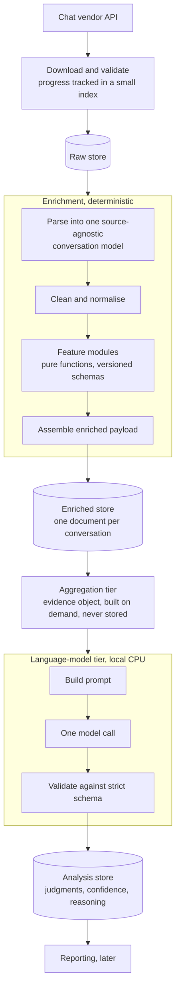

# Architecture

The design rule is **deterministic first, model second**. Code computes every fact that can be verified. The model is asked only for judgment, and only after the facts have been computed and checked.



## The deterministic side

1. **Download.** Collects conversation identifiers, downloads each transcript, validates it, and tracks progress in a small index. Authentication is refreshed centrally.
2. **Parse and clean.** Each raw conversation is parsed into one source-agnostic model of conversations, messages and participants (visitor, operator, bot, system, unknown). Everything downstream depends only on that model, so a new chat source means a new parser and no downstream change. Cleaning normalises timestamps, roles and text.
3. **Feature modules.** A set of small, independent modules in four groups computes the facts:
   - **structural:** timing, conversation flow (turns, bursts, unanswered turns), message statistics;
   - **business:** business rules, such as whether an agent was involved and how many responses were slow;
   - **language:** linguistics (courtesy, emotion words, style, service behaviour by role), entities (personal-data and order-reference patterns), readability;
   - **metadata:** channel and conversation metadata.
4. **Enriched payload.** The module outputs are assembled into one document per conversation, namespaced by module. Every value is a timestamp, a role, a count or a transcript. None is a judgment.

Every module was run against the whole corpus with zero exceptions before the next stage was built on it.

## The tier rule

```
shared model  <  enrichment  <  domain kernel  <  leaf feature modules  <  aggregation  <  language-model tier
```

- **Leaf modules import only from lower layers and never from each other.** Each is a pure function of a conversation and returns its own frozen result type.
- **Only the aggregation tier may read several modules' outputs together.**
- **Every result type carries a version.** The version is bumped whenever its shape changes, so consumers can tell which contract they hold.

## The evidence object

The aggregation tier builds, on demand and never stored, a curated view for the model: conversation context, a clean dialogue-only transcript, timing, flow, message statistics, language signals for each role, the customer's behaviour, and the service behaviour of the agent. It computes no new facts; it only projects and renames what the leaf modules produced.

It deliberately excludes every judgment (resolved or not, issue resolved, and so on). Those are what the model produces, and keeping them out of the evidence is what keeps the pipeline explainable and auditable.

## The language-model tier

- **One call per conversation.** The evidence is compact, and one instruction is tractable for a model of roughly 7-8 billion parameters.
- **Structured output, strict schema, lenient values.** The model returns JSON that is validated against a typed schema. A malformed field falls back to a default and is logged. Nothing a model returns can crash the batch, and every failure is logged with the conversation and the raw response.
- **Local inference on a CPU-only machine.** No cloud API and no GPU. The model runs through a local runtime with retries, a generous timeout and logging of tokens and latency for every call.
- **Sequential by design.** On this hardware, decoding is limited by memory bandwidth, not compute. A second model process would split the same bandwidth and double the memory use, and batching helps only the prefill phase. The levers that do help are a smaller model, heavier quantisation, tight output budgets and reusing the shared prompt prefix. It is an overnight batch job.
- **Output kept separate from evidence.** Each analysis is stored apart from the enriched payload, in the same one-document-per-conversation shape.

## Design choices and why

- **Facts and judgments are never mixed.** The model reads facts and writes judgments in a different place, so every rating can be traced back to the signals behind it.
- **Pure, independent feature modules.** A new signal is a new module, and a change in one cannot break another.
- **Mature core first.** The deterministic layer was completed and verified before any model work began, so the model sits on ground that was already trusted.
- **Honest about cost.** The throughput maths was done before building, and the pipeline was designed as an overnight batch, not a real-time service.
