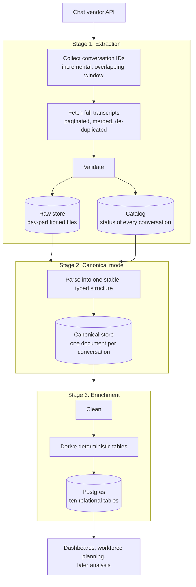

# Architecture

The pipeline is a three-stage chain on a shared platform. Each stage is its own project with its own schedule, and the stages meet only at the data: stage two reads what stage one wrote, stage three reads what stage two wrote. No stage imports another stage's code.

## The platform underneath

A shared Python package provides configuration, storage, validation and an AI-provider interface. It contains **no orchestrator code**: the orchestrator lives in its own package and composes the projects. Two rules keep it clean:

- **Capabilities live in the shared package, business logic lives in the projects.** A project says which sources, rules and order apply; the shared package says how to store, validate and configure. Generic code that grows inside a project is the signal to move it down.
- **The data uses a medallion layout.** Files for raw and intermediate data; Postgres for clean, canonical and enriched data.

## The three stages

1. **Extraction.** Collects conversation identifiers with an incremental window that deliberately overlaps the previous run, so a missed run heals itself on the next one. For each conversation it fetches the full transcript across pages, merges and de-duplicates the messages, validates the result and writes it to a day-partitioned raw store. A catalog records the status of every conversation. After the coverage fix described in [reliability-and-tests.md](reliability-and-tests.md), extraction also rechecks conversations that were still open when first seen, and refreshes conversations on a messaging-app channel in full each run.
2. **Canonical model.** Parses each raw conversation into one stable, typed structure: messages in order, who sent each, timing and attributes. It decides what to rebuild by comparing what it has built against the raw data's version and last-modified time, so a change upstream is noticed automatically.
3. **Enrichment.** Cleans each canonical conversation and derives ten deterministic relational tables in Postgres. A later addition computes an hourly agent-activity table from them, and a set of workforce-planning views sits on top. Four of the tables need the same turn, burst and role-transition detection, so that logic is one shared helper, not four copies. Eligibility is derived from two things: the stage's own schema version and the canonical version it last processed. A change to either rebuilds the affected conversations.

## Design choices and why

- **Stages meet at the data, not in code.** Each stage is built, run and tested on its own. The cost is a little duplication; the benefit is that a change in one stage cannot break another at import time.
- **Eligibility is recalculated every run, not stored as a progress cursor.** An interrupted run is safe to resume, and a run can be repeated without reprocessing fresh conversations.
- **One bad conversation never stops a batch.** The failure is logged against the conversation and recorded for review, and the rest continue.
- **Deterministic tables only.** Everything in the tables is a structural fact or a computed metric. Anything that needs judgment is a separate, later stage.
- **Writes are idempotent per conversation.** A conversation's rows are replaced as a unit, so a re-run never leaves partial data.
- **Narrow ports from the earlier platform.** The ten tables were built against the canonical model directly, reusing only the pieces of earlier logic each table needed, instead of porting the old object model whole.

## How it runs

The three jobs run nightly on a staggered schedule, extraction first, then canonical, then enrichment, so each finds fresh input. Each run takes a lock so two runs of the same stage cannot overlap, and records its outcome in a run-history table. A separate watchdog reads that history each morning (see [reliability-and-tests.md](reliability-and-tests.md)).
