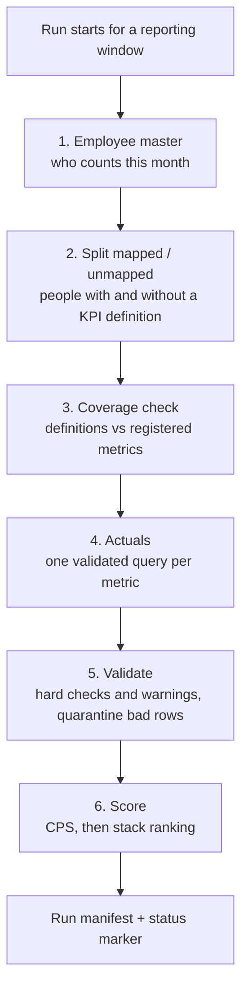
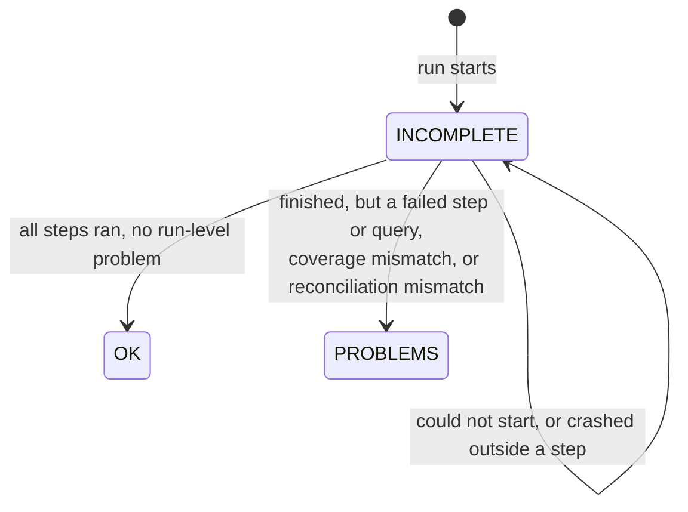

# Architecture

A run produces one Combined Performance Score (CPS) per employee for a reporting window, normally a month. Every run combines two halves:

- **Actuals:** what each person actually did, taken from the data warehouse (Amazon Redshift) with one validated SQL query per metric.
- **Definitions and targets:** which KPIs apply to which role, and each KPI's target, weight and direction. The business had no write access to a warehouse table for these, so they live in a versioned file that is edited by hand.

A single entry point runs six steps in a fixed order against one shared warehouse connection. Steps pass data to each other in memory through one shared context object, not through intermediate files. Everything a run produces lands in one run folder.

## The six steps

1. **Employee master.** Fetches who was employed during the window and classifies each person as full-month, joined mid-window, left mid-window, or both. The master is saved before anything else can fail. KPI definitions are then matched for full-month employees.
2. **Split mapped and unmapped.** People who matched a KPI definition continue to scoring. People who did not are written to a file for review, so a missing mapping is visible and never silently dropped.
3. **Coverage check.** Compares the definitions file against the metrics that are actually registered in the pipeline, and flags any mismatch.
4. **Actuals.** Runs every registered metric query for the window, then drops rows for anyone outside the employee master. Per-source record counts are checked separately.
5. **Validate.** Runs hard checks and warnings over the actuals (see [validation-and-tests.md](validation-and-tests.md)). Rows that fail a hard check are quarantined and reported, not scored.
6. **Score.** Builds the scoring frame, separates genuine KPI gaps, computes CPS and the stack ranking, adds exit status, and writes the final outputs together with a not-scored report.

If a step raises an error, the remaining steps are skipped and the run exits with a failure code. A single failed metric query inside a step is recorded as a problem but does not stop the run.

## Design choices and why

- **One scoring method for every role.** Weights differ per department but always sum to 100%, so scores are comparable. Eligibility is kept out of the score on purpose.
- **A fixed step order with a shared in-memory context.** Each step reads what earlier steps produced and writes what later steps need. There are no hidden intermediate files to go stale.
- **Missing data is made visible, not zero-filled by default.** Metrics whose query failed, or whose source had no records in the window, are excluded from zero-filling. People without a definition are reported.
- **Traceability over convenience.** Every run records its parameters, the version of the code that ran, a fingerprint of the definitions file, and what each step did.
- **Manual inputs stay manual and are named.** Targets are confirmed by a person, and a run that finishes with problems still writes scores but must be read before it is trusted.

## Run folder and status

Each run gets its own folder, created at the start with an `INCOMPLETE` suffix. It is renamed only at the very end, once the final status is known:

A run manifest is written into the folder just before the rename. It records the run's identity and timing, each step's outcome and duration, problems and warnings, parameters, the code version and environment, the row counts of every output file, and the reconciliation results. It never holds credentials, email addresses or names.

## What is automated and what is not

Automated: the six steps, the reconciliation and coverage checks, writing all outputs, writing the manifest and status marker, and deciding the exit code.

Needs a person: setting up access to the warehouse, confirming each KPI's target, reviewing any run that ended with problems before using its output, and regenerating the KPI catalogue after a metric is added.
